# Plexus NOC – Network Operation Center Monitoring App

A production-style **Network Operation Center (NOC) monitoring mobile application** built with Flutter following **Clean Architecture** and **BLoC pattern**. The app simulates real-time monitoring of network devices including health metrics, connectivity, alerts, and geographic visualization.

Designed to demonstrate **scalable Flutter architecture**, **real-time data handling**, and **performance-optimized UI patterns**.

---

# Features

## Authentication

- Email & password login
- Form validation
- Clean architecture usecase driven login flow
- BLoC state handling

Dummy credentials:

```
admin@plexus.com
password123
```

---

## Real-Time Dashboard

Dashboard provides network health overview:

- Total devices
- Online devices
- Offline devices
- Critical alerts
- Recent alerts

### Critical Alerts Include:

- Offline devices
- High CPU usage
- High RAM usage

### Alert Behavior:

| Feature            | Behavior                      |
| ------------------ | ----------------------------- |
| Dashboard popup    | Only visible on dashboard     |
| Local notification | Works globally                |
| Alert counter      | Includes offline + high usage |
| Real-time updates  | Automatic polling             |

---

## Device Monitoring System

### Smart Pagination

To maintain performance:

- Devices load in pages
- **10 devices per page**
- Lazy loading
- Optimized scrolling

### Search System

Search by:

- Device name
- IP address

### Filtering System

Filter options:

- All devices
- Online devices
- Offline devices

---

## Device Details Monitoring

Detailed device health monitoring page shows:

### Device Info:

- Device name
- IP address
- Location
- Last ping
- Status

### Performance Monitoring:

- CPU usage updates every **1 second**
- Memory usage updates every **1 second**
- Real-time graphs using **fl_chart**

---

## Network Map Visualization

Map page provides geographic monitoring.

Features:

- All devices displayed
- Online indicator
- Offline indicator
- Clickable markers

**(Selected Filtered devices from **Device List** screen shows in the **MAP**)**
_Example: If you filter devices by "Online" from **Device List** screen, then only online devices will show in the **MAP** screen_

Clicking marker shows:

- Device name
- Status
- IP address
- Location

---

## Offline First Architecture

The app includes intelligent offline support.

### When network fails:

- Shows last cached data
- Data loaded from Hive storage
- No crash
- No empty UI state

### When network returns:

- Live data replaces cache immediately

---

## Smart Data System

Device data comes from mock telemetry.

Because generation is heavy:

- Generation isolated
- Processing separated from UI
- Prevents UI freeze
- Improves performance

---

## Polling Based Updates

Instead of manual refresh:

System uses polling:

- Device updates automatic
- Alert updates automatic
- Graph updates automatic

Pull-to-refresh added as backup.

---

## Notifications

Local notification system triggers for:

- Offline devices

Notifications work globally across app.

---

## Theme System

Supports:

- Light theme
- Dark theme
- Runtime switching
- Theme persistence

---

# Architecture

This project follows **Clean Architecture**:

```
Presentation → Domain → Data
```

### Architecture Principles:

- Separation of concerns
- Dependency inversion
- Feature based structure
- Scalable architecture
- Testable business logic

---

# Project Structure

```
lib/

core/
│
├── constant/
├── extensions/
├── navigation/
├── network/
├── services/
├── theme/
└── usecases/

features/

├── auth/
├── device_monitoring/
├── settings/
└── splash/

injection_container.dart
main.dart
```

---

# Core Module

Contains reusable infrastructure:

## Core Components:

### Constants

- App colors
- App strings

### Navigation

- App router
- Main wrapper screen

### Network

- Network cubit
- Connection detection
- Global network wrapper

### Services

- Local notification service

### Theme

- Light/Dark theme config

### Extensions

- Responsive UI helpers

---

# Feature Modules

Each feature follows:

```
feature/
├── data/
├── domain/
└── presentation/
```

---

# Auth Feature

```
auth/

data/
├── datasources/
└── repositories/

domain/
├── entities/
├── repositories/
└── usecases/

presentation/
├── cubit/
├── pages/
└── widgets/
```

Handles:

- Login logic
- Validation
- State management
- UI

---

# Device Monitoring Feature (Main Feature)

Largest module.

Handles:

- Dashboard
- Device list
- Device details
- Map
- Alerts
- Notifications

## Data Layer

```
datasources/
├── device_local_datasource
├── device_remote_datasource
├── mock_device_datasource
```

## Domain Layer

Entities:

- DeviceEntity
- AlertEntity

Usecases:

- Get devices stream
- Get alerts stream
- Check internet connection
- Listen internet changes

## Presentation Layer

State management:

- Dashboard BLoC
- Device list BLoC
- Device details BLoC
- Alert Cubit

UI:

- Dashboard
- Device monitoring
- Device details
- Map
- Notifications

Reusable widgets:

- Dashboard cards
- Device tiles
- Charts
- Search bar
- Filters
- Alert components

---

# Settings Feature

Handles:

- Theme switching
- UI preferences

Uses:

- Theme Cubit
- Theme state

---

# Splash Feature

Handles:

- App initialization
- Routing logic
- Startup checks

---

# State Management

Uses:

**Flutter BLoC**

Patterns used:

- Cubit for simple state
- Bloc for complex state
- Stream driven updates
- Separation of UI & logic

---

# Dependency Injection

Uses service locator pattern:

```
injection_container.dart
```

Manages:

- Repositories
- Datasources
- Usecases
- Blocs
- Services

---

# Technologies Used

## Core

- Flutter
- Dart

## Architecture

- Clean Architecture
- BLoC Pattern
- Repository Pattern
- Dependency Injection

## Storage

- Hive
- hive_flutter

## Visualization

- fl_chart

## Maps

- Google Maps Flutter

## Notifications

- Flutter Local Notifications

---

# Performance Optimizations

Implemented optimizations:

- Pagination
- Lazy loading
- Polling updates
- Local caching
- Data isolation
- Stream updates
- Optimized BLoC rebuilds

---

# How Data Flows

```
Mock Data Source
      ↓
Repository Implementation
      ↓
Usecases
      ↓
BLoC / Cubit
      ↓
UI
```

---

## Isolate Strategy — Mock Device Simulation

### Problem

The mock device datasource simulates **100 network devices** with two high-frequency timers running on the main thread:

| Timer          | Interval   | Work                                                       |
| -------------- | ---------- | ---------------------------------------------------------- |
| Telemetry tick | 1 second   | Recalculates CPU & memory for every online device          |
| Status toggle  | 10 seconds | Randomly toggles 1–3 devices online/offline + fires alerts |

This creates **continuous computation every second** (100 Random calls, 100 map mutations, list copies) that competes with Flutter's UI rendering, causing frame drops and jank — especially on lower-end devices.

### Solution

All simulation logic is offloaded to a **background Dart isolate** via `Isolate.spawn`. The main-thread `MockDeviceDataSource` becomes a thin proxy.

```
┌─────────────────────────────────┐   SendPort    ┌────────────────────────────┐
│  MockDeviceDataSource           │◄──────────────│  _isolateEntryPoint()      │
│  (main thread — thin proxy)     │   JSON maps   │  (background isolate)      │
│                                 │               │                            │
│  ReceivePort → decode →         │               │  Owns:                     │
│   _deviceStreamController       │               │   • Random instance        │
│   _alertStreamController        │               │   • Timer.periodic (1s)    │
│                                 │               │   • Timer.periodic (10s)   │
│  Exposes unchanged interface:   │               │   • 100-device list        │
│   getRealtimeDevicesStream()    │               │   • All mutation logic     │
│   getRealtimeAlertsStream()     │               │                            │
└─────────────────────────────────┘               └────────────────────────────┘
```

**Data flow:**

1. The isolate generates / mutates device data and encodes it as `List<Map<String, dynamic>>`.
2. It sends messages via `SendPort` with a `type` field (`'devices'` or `'alert'`).
3. The main-thread proxy decodes JSON maps into `DeviceModel` / `AlertEntity` and pushes them to broadcast `StreamController`s.
4. Blocs and repositories consume the streams as before — **zero API changes**.

### Why This Is Good

| Benefit                      | Explanation                                                                                                                    |
| ---------------------------- | ------------------------------------------------------------------------------------------------------------------------------ |
| **Eliminates UI jank**       | Timer callbacks and 100-device mutations no longer block the main thread's rendering pipeline.                                 |
| **Scalable**                 | The device count can grow (500, 1000+) without degrading UI performance — compute stays off the main thread.                   |
| **Zero breaking changes**    | `DeviceRemoteDataSource` interface is unchanged; repositories, use cases, and blocs are completely untouched.                  |
| **Clean Architecture**       | The isolate is an implementation detail of the data layer — domain and presentation layers have no knowledge of it.            |
| **Simple lifecycle**         | `dispose()` calls `Isolate.kill()` for immediate cleanup; no complex shutdown handshake needed.                                |
| **Production-ready pattern** | When replacing mocks with real WebSocket/API data, the same isolate pattern can parse heavy JSON payloads off the main thread. |

### Key File

- [`mock_device_datasource.dart`](lib/features/device_monitoring/data/datasources/mock_device_datasource.dart)

---

# Key Engineering Decisions

Why polling instead of refresh?

Because NOC systems require:

- Continuous monitoring
- Live updates
- No manual refresh

Why Clean Architecture?

Because it provides:

- Maintainability
- Scalability
- Testability
- Separation of concerns

Why Hive?

Because it provides:

- Fast local storage
- Lightweight DB
- Offline support

---

# Screenshots

<p align="center">
  <b>Light Theme</b><br><br>

  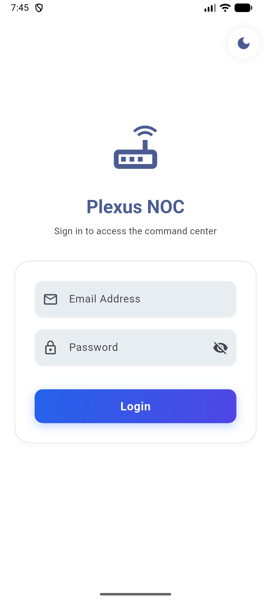
  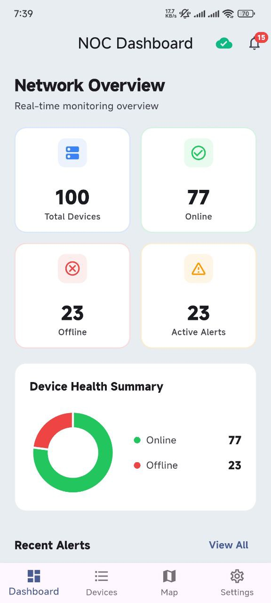
  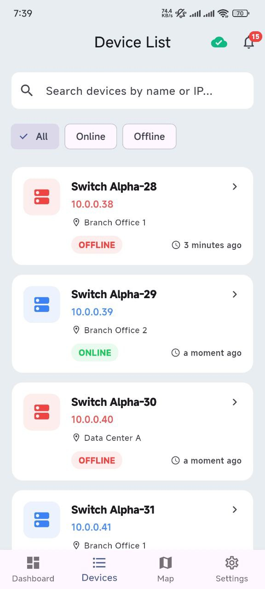
  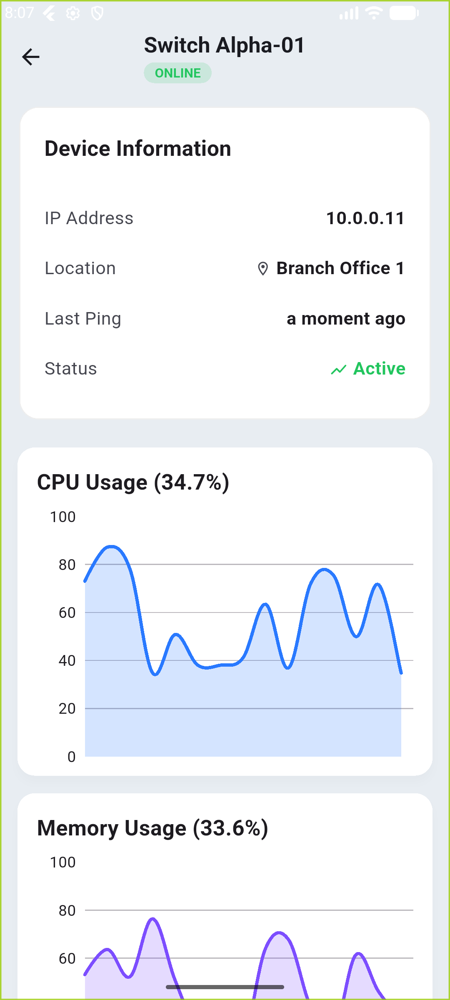
  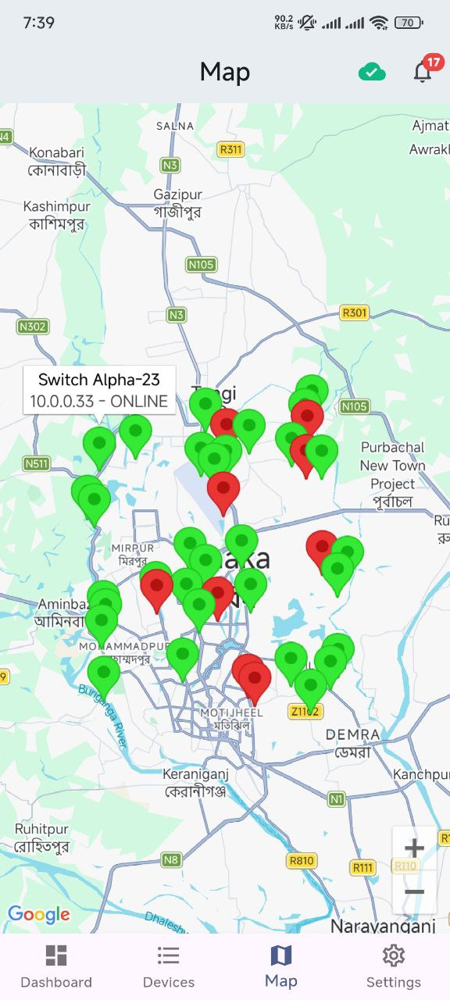
  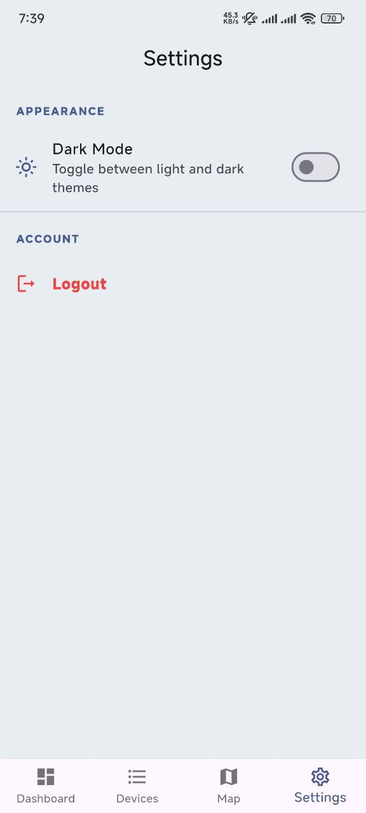
</p>

<p align="center">
  <b>Dark Theme</b><br><br>
  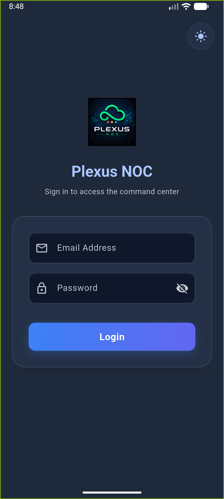
  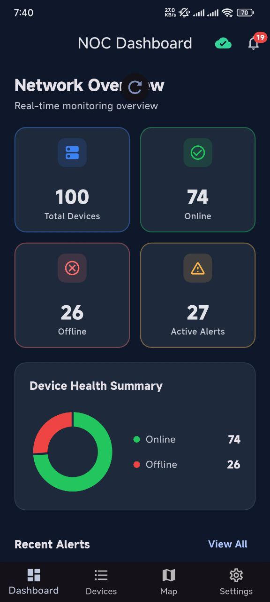
  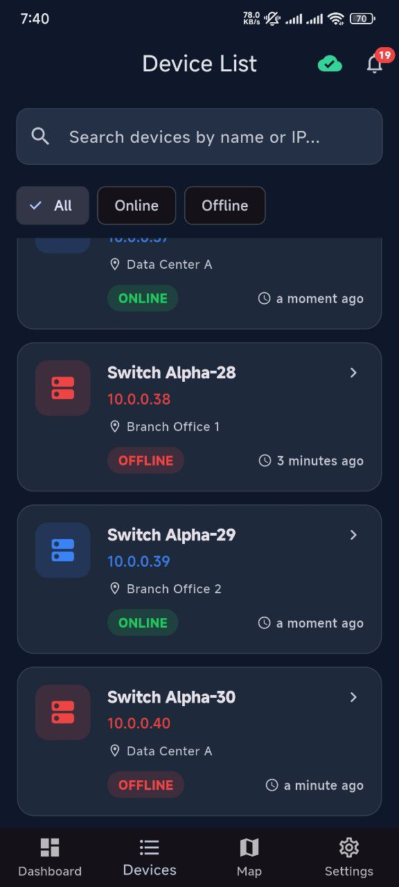
  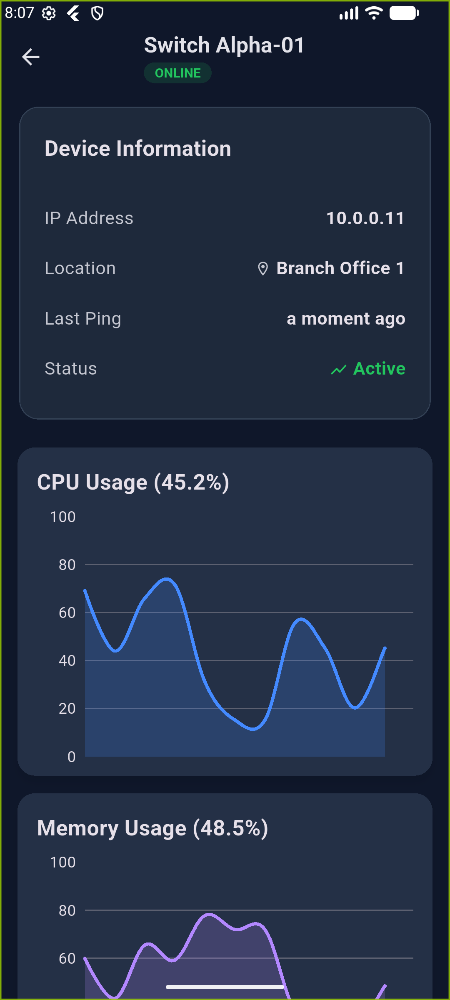
  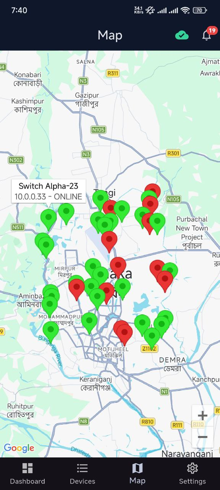
  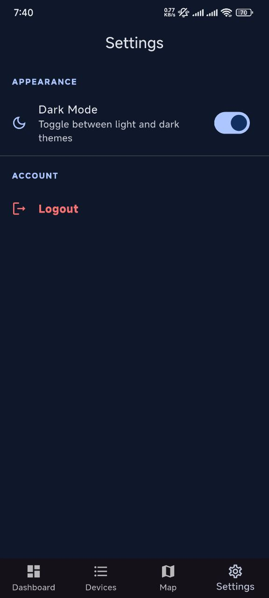
</p>

---

# Installation

**Important Note:** This project relies on environment variables for API keys and other secrets. Before running the project, you **must** create a `.env` file.

1. Create a file named `.env` in the root directory of the project.
2. Add your Google Maps API key (or a dummy key for testing) to the file as shown below:

```env
MAPS_API_KEY=AIzaSy_YOUR_DUMMY_API_KEY_HERE
```

Then, you can run the project:

```bash
git clone https://github.com/The-Black-Shadow/plexus_noc

cd plexus_noc

# Ensure you have your .env file created first!

flutter pub get

flutter run
```

---

# Requirements

- Flutter 3.x
- Dart 3.x
- Android Studio / VSCode

---

# Project Purpose

This project demonstrates:

- Production Flutter architecture
- Real-time monitoring design
- Enterprise architecture patterns
- BLoC best practices
- Offline first design
- Scalable feature structure

---
